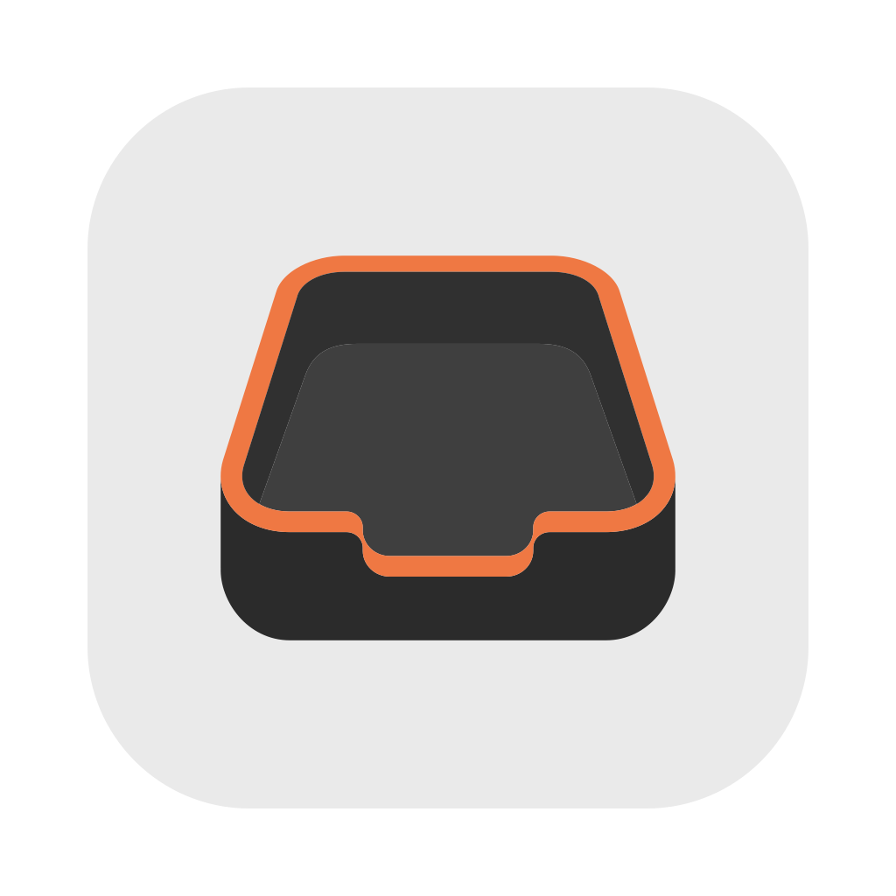
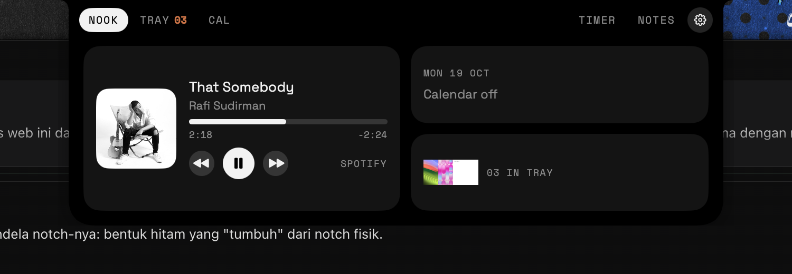
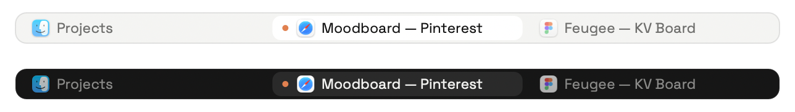
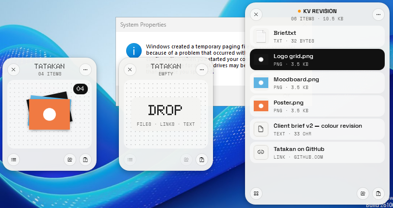

<p align="center">
  
</p>

<h1 align="center">Tatakan</h1>

<p align="center">
  Rak drag-and-drop buat file, di <b>macOS</b> dan <b>Windows</b>.<br>
  Di Mac ada bonus panel kecil yang muncul dari notch.<br>
  Native di dua-duanya. Gratis dan open source (MIT).
</p>

<p align="center"><a href="README.md">Read in English</a></p>

---

Tatakan itu tempat naruh barang sebentar. Begitu juga app ini: taruh file dulu selagi pindah-pindah app, nanti tinggal drag keluar ke tempat tujuannya.



## Fitur

| | macOS | Windows |
|---|:---:|:---:|
| **Shelf**: goyangin pointer pas lagi nge-drag, rak melayang muncul | ✅ | ✅ |
| Taruh file, folder, link, teks, gambar; drag keluar lagi | ✅ | ✅ |
| Banyak rak sekaligus, kasih nama & warna, Recent Shelves | ✅ | ✅ |
| Copy, buka, simpan/pindah ke folder, ZIP | ✅ | ✅ |
| Resize & convert gambar, ambil teks dari gambar (OCR) | ✅ | ✅ |
| Share | ✅ AirDrop, Messages, Mail | ✅ Nearby Share, Mail, app lain |
| **Tab Groups**: gabungin window apa aja jadi satu, dengan strip tab di atasnya | ✅ | — khusus Mac |
| **Nook**: panel notch (Now Playing, Tray, Kalender, Timer, Notes) | ✅ | — khusus Mac |
| Mirror, notifikasi Bluetooth & baterai di notch | ✅ | — khusus Mac |

Fitur notch cuma ada di Mac, karena notch-nya memang cuma ada di MacBook. Versi Windows fokus ke rak-nya.

### Tab Groups (Mac, beta)

Nyalain **Tab Groups** dari ikon Tatakan di menu bar (default-nya mati). macOS bakal minta izin Accessibility sekali, karena cuma lewat izin itu app bisa mindahin window app lain.

- **Bikin grup**: seret window dari title bar ke **tengah** window lain, terus diam ½ detik. Labelnya berubah dari *Hold to tab* jadi *Tab*. Lepas. App-nya boleh beda-beda, misalnya Figma + brief PDF + Safari.
- **Ganti tab**: klik tab-nya, atau `⌃⌥⇥` / `⌃⌥⇧⇥`.
- **Geser grup**: seret window yang lagi kelihatan, strip-nya ikut.
- **Urutin**: seret tab ke samping. **Cabut**: seret tab keluar dari strip.
- **Klik kanan tab**: Close Tab, Move Out of Group, Separate All Tabs.
- App yang nggak mau digabung, masukin ke **Settings → Never group these apps**.

Tab yang lagi disembunyiin nunggu di luar pojok layar. Pas Tatakan di-quit (atau dimatiin paksa), semuanya balik ke layar.





## Instal di Mac

Bisa di **Mac Apple Silicon maupun Intel**, minimal **macOS 14 Sonoma**.

### Cara 1: Installer (.pkg) — paling gampang

1. Download **`Tatakan-x.y.z.pkg`** dari [release terbaru](https://github.com/reihanalka/tatakan/releases/latest).
2. Double-click. Kalau macOS bilang developer-nya nggak bisa diverifikasi, buka **System Settings → Privacy & Security**, scroll ke bawah, klik **Open Anyway**, lalu buka installer-nya lagi.
3. Ikuti langkahnya sampai selesai. Tatakan kebuka sendiri dan ikonnya ada di menu bar.

### Cara 2: Terminal, satu baris

```bash
curl -fsSL https://raw.githubusercontent.com/reihanalka/tatakan/main/scripts/install.sh | bash
```

### Cara 3: Disk image (.dmg)

Buka **`Tatakan-x.y.z.dmg`**, drag Tatakan ke Applications, lalu izinkan sekali di **System Settings → Privacy & Security → Open Anyway**.

> [!NOTE]
> Tatakan belum dinotarisasi Apple (butuh akun developer berbayar), jadi macOS kasih peringatan di pembukaan pertama. Installer .pkg dan Terminal udah ngurusin itu.

**Uninstall:** Quit dari ikon menu bar, buang `/Applications/Tatakan.app` ke Trash.

## Instal di Windows

Bisa di **Windows 10 (1809 ke atas) dan Windows 11**, PC biasa (**x64**) maupun **ARM64** (Snapdragon / Surface). Satu installer buat semua.

### Cara 1: Installer (.exe) — paling gampang

1. Download **`Tatakan-Setup-x.y.z.exe`** dari [release terbaru](https://github.com/reihanalka/tatakan/releases/latest).
2. Jalankan. Kalau muncul **Windows protected your PC**, klik **More info → Run anyway**.
3. Klik Next sampai selesai. Kalau PC-nya belum punya **.NET 8 Desktop Runtime** (gratis dari Microsoft, ±55 MB), installer otomatis download dan minta izin admin sekali.
4. Tatakan jalan di pojok kanan bawah (notification area). Kadang ngumpet di tombol **^**; drag ikonnya ke taskbar biar selalu kelihatan.

### Cara 2: PowerShell, satu baris

```powershell
irm https://raw.githubusercontent.com/reihanalka/tatakan/main/windows/install.ps1 | iex
```

Otomatis download installer terbaru, pasang, nyalain *start saat login*, dan buka Tatakan. Jalanin lagi buat update.

> [!NOTE]
> Versi Windows belum ditandatangani sertifikat (bayar tiap tahun), makanya SmartScreen kasih peringatan. File-nya dibuat GitHub Actions langsung dari repo ini; bisa dicek pakai `SHA256SUMS-windows.txt` di halaman release.

### Cara pakai di Windows

- **Buka rak**: pas lagi nge-drag file, goyangin pointer kiri-kanan. Atau tekan **Ctrl+Alt+Space**, atau klik ikon tray.
- **Taruh** file, folder, link, teks, atau gambar. **Drag** tumpukannya keluar buat naruh semua, atau klik buat lihat daftarnya.
- **Klik kanan** item (atau tombol **⋯**): Open, Copy, Save to Folder, ZIP, Image, Share…
- **Shortcut di rak**: `Ctrl+C` `Ctrl+V` `Ctrl+A` · `Del` hapus · `Enter` buka · `F2` ganti nama · `Esc` tutup.
- **Settings** (klik kanan ikon tray): sensitivitas goyang, app yang dikecualikan, start saat login.

**Uninstall:** *Settings → Apps → Installed apps → Tatakan → Uninstall*.

## Build sendiri

Langkah lengkap (Mac & Windows) ada di [README bahasa Inggris](README.md#build-from-source).

## Lisensi

Kode: MIT. Font: SIL OFL 1.1. Nama dan logo "Tatakan" nggak termasuk lisensi MIT, lihat [TRADEMARKS.md](TRADEMARKS.md). Fork boleh banget, asal pakai nama dan ikon sendiri.
