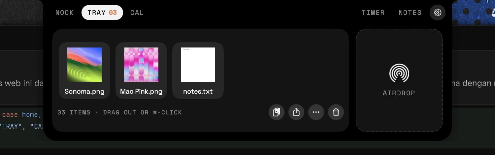
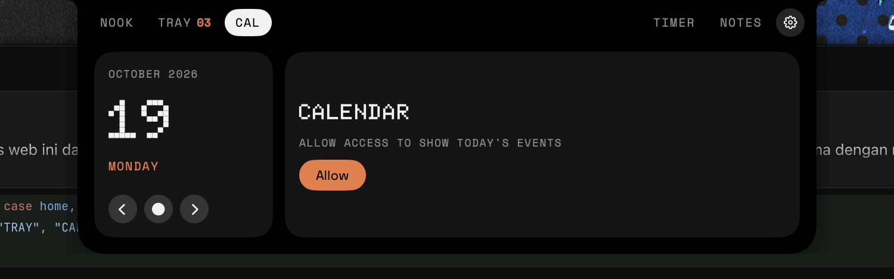
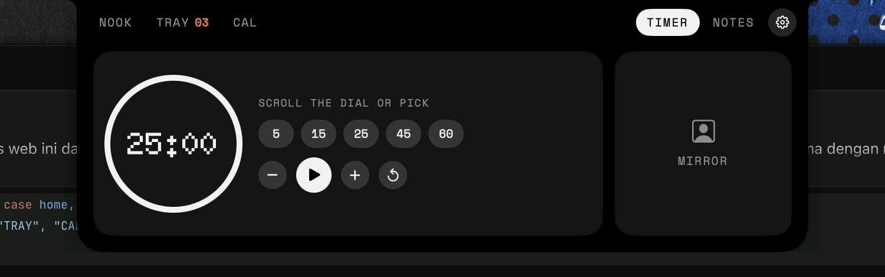
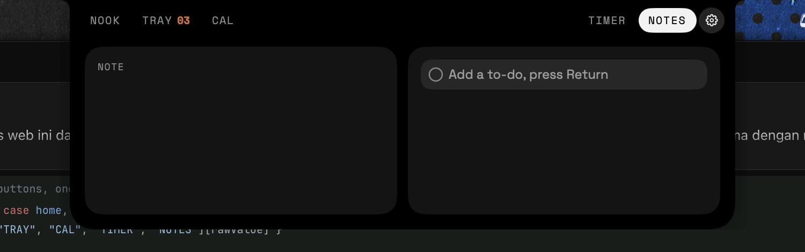
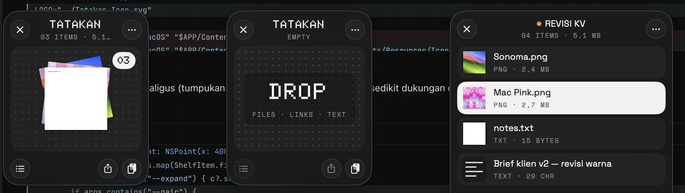

<p align="center">
  
</p>

<h1 align="center">Tatakan</h1>

<p align="center">
  A drag-and-drop shelf for files, plus a small panel that grows out of the MacBook notch.<br>
  Native Swift. Free and open source under MIT.
</p>

<p align="center">
  <a href="https://github.com/reihanalka/tatakan/releases/latest"></a>
  <a href="LICENSE"></a>
  
  
</p>

<p align="center"><a href="README.id.md">Baca dalam Bahasa Indonesia</a></p>

---

*Tatakan* is Indonesian for a tray or coaster: a small place to set things down for a moment. That's the whole idea. Park files while you move between apps, then drag them out where they need to go.


## Features

- **Shelf**: shake the pointer while dragging anything and a floating shelf appears. Drop files in, drag them out later.
- **Item actions**: copy, reveal in Finder, share, AirDrop, quick thumbnails.
- **Nook**: a black panel at the notch with tabs for Now Playing, Tray, Calendar (today's events), Timer and Notes. On screens without a notch it shows as a slim pill at the top.
- **Mirror**: a quick camera check before a call. Nothing is recorded.
- **Bluetooth notices**: a small notice when headphones or other devices connect.
- Light and dark mode, one accent colour (`#F07A42`).

<p>
  
  
  
  
</p>



## Install

Works on **Apple Silicon and Intel Macs** with **macOS 14 Sonoma or newer**.

### Option 1: Installer (.pkg) — easiest

1. Download **`Tatakan-x.y.z.pkg`** from the [latest release](https://github.com/reihanalka/tatakan/releases/latest).
2. Double-click it. If macOS says it can't verify the developer, open **System Settings → Privacy & Security**, scroll down and click **Open Anyway**, then run the installer again.
3. Click through the installer. Tatakan opens by itself and shows up in the menu bar.

### Option 2: Terminal, one line

```bash
curl -fsSL https://raw.githubusercontent.com/reihanalka/tatakan/main/scripts/install.sh | bash
```

Downloads the latest release, puts it in `/Applications` and opens it. Run the same line again to update.

### Option 3: Disk image (.dmg)

Open **`Tatakan-x.y.z.dmg`**, drag Tatakan into Applications, then allow it once in **System Settings → Privacy & Security → Open Anyway**.

> [!NOTE]
> Tatakan is not notarized by Apple yet (that needs a paid developer account), so macOS shows a warning the first time. The .pkg and the Terminal installer both clear it for you. The app has no network features and only asks for Calendar, Bluetooth and Camera when you use those tabs.

### Uninstall

Quit Tatakan from its menu-bar icon, then move `/Applications/Tatakan.app` to the Trash.

## Build from source

You only need Apple's Command Line Tools (`xcode-select --install`). No Xcode project.

```bash
git clone https://github.com/reihanalka/tatakan.git
cd tatakan
./Tatakan/build.sh              # builds for your Mac's CPU
open Tatakan/build/Tatakan.app
```

`build.sh` compiles the SVG helper (`Tools/assettool.swift`), regenerates the app icon and menu-bar glyph from `Tatakan_Icon.svg` and `Tatakan_Icon_2.svg`, compiles `Sources/*.swift`, builds the now-playing adapter (`Resources/MediaAdapter.m`) and signs the bundle.

Options:

| Variable | Effect |
|---|---|
| `UNIVERSAL=1` | One app for Apple Silicon + Intel |
| `SIGN=-` | Force ad-hoc signing |

To build every release file (`.pkg`, `.dmg`, `.zip`) into `dist/`:

```bash
./scripts/make-release.sh
```

## Project layout

```
Tatakan_Icon.svg          colour logo → app icon
Tatakan_Icon_2.svg        mono logo   → menu-bar template glyph
Tatakan/
├── build.sh
├── Info.plist
├── Sources/              Swift (AppDelegate, Shelf, Notch, Actions, Theme, …)
├── Resources/            fonts (OFL), icons, MediaAdapter.m
└── Tools/assettool.swift font list + SVG → PNG
installer/                .pkg installer (welcome page, pre/postinstall scripts)
scripts/
├── make-release.sh       builds dist/*.pkg, *.dmg, *.zip
└── install.sh            one-line Terminal installer
docs/screenshots/
```

## Notes for contributors

- **Now Playing** reads Apple's private `MediaRemote` framework through a small dylib loaded by `/usr/bin/perl`. It's a workaround, not a public API. It may break in a future macOS, and it would not pass App Store review.
- Permissions asked at runtime: Calendar, Bluetooth, Camera. Nothing leaves the Mac.
- Some APIs used are deprecated (you'll see compiler warnings). They still work on macOS 14–27. PRs welcome.
- Intel builds compile and are included in releases, but the author tests on Apple Silicon. Reports from Intel Macs are very welcome.

See [CONTRIBUTING.md](CONTRIBUTING.md) to get started.

## License

- **Code**: [MIT](LICENSE) © 2026 Reihan Al Kautsar
- **Fonts**: Doto, Space Grotesk and Space Mono, [SIL Open Font License 1.1](Tatakan/Resources/Fonts)
- **Name & logo**: "Tatakan" and its icon are **not** covered by the MIT license. See [TRADEMARKS.md](TRADEMARKS.md) and [NOTICE](NOTICE). Forks are welcome, just give them their own name and icon.
