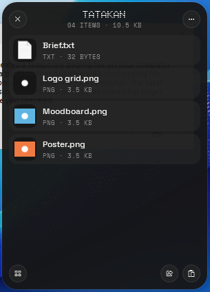
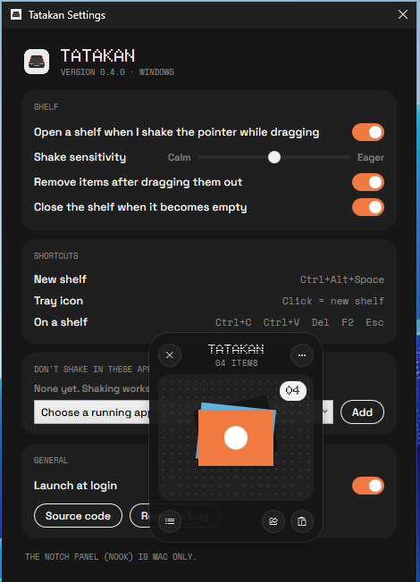

<p align="center">
  
</p>

<h1 align="center">Tatakan</h1>

<p align="center">
  A drag-and-drop shelf for files on <b>macOS</b> and <b>Windows</b>.<br>
  On a Mac it also grows a small panel out of the notch.<br>
  Native on both. Free and open source under MIT.
</p>

<p align="center">
  <a href="https://github.com/reihanalka/tatakan/releases/latest"></a>
  <a href="LICENSE"></a>
  
  
</p>

<p align="center"><a href="README.id.md">Baca dalam Bahasa Indonesia</a></p>

---

*Tatakan* is Indonesian for a tray or coaster: a small place to set things down for a moment. That's the whole idea. Park files while you move between apps, then drag them out where they need to go.


## Features

| | macOS | Windows |
|---|:---:|:---:|
| **Shelf**: shake the pointer while dragging, a floating shelf appears | ✅ | ✅ |
| Drop files, folders, links, text and images; drag them out again | ✅ | ✅ |
| Multiple shelves, names, colours, Recent Shelves | ✅ | ✅ |
| Copy, open, reveal, save/move to folder, ZIP | ✅ | ✅ |
| Resize and convert images, extract text (OCR) | ✅ | ✅ |
| Share sheet | ✅ AirDrop, Messages, Mail… | ✅ Nearby Share, Mail, apps… |
| Quick Look (Space) | ✅ | — |
| **Tab Groups**: drop any window on another and hold, they share one frame under a tab strip | ✅ | — Mac only |
| **Nook**: notch panel with Now Playing, Tray, Calendar, Timer, Notes | ✅ | — Mac only |
| Mirror, Bluetooth and battery notices in the notch | ✅ | — Mac only |
| Light and dark mode, one accent colour (`#F07A42`) | ✅ | ✅ |

The notch features only exist on the Mac, because that's where the notch is. The Windows version is the shelf, done properly.

### Tab Groups (Mac, beta)

Turn on **Tab Groups** from the menu bar icon (it's off by default). macOS asks once for Accessibility, which is how any app moves other apps' windows.

- **Make a group**: drag a window by its title bar onto the middle of another window and keep still for half a second. The outline changes from *Hold to tab* to *Tab*. Let go. Any apps can share a group, e.g. Figma + a PDF brief + Safari.
- **Switch**: click a tab, or `⌃⌥⇥` / `⌃⌥⇧⇥`.
- **Move the group**: drag the visible window; the strip follows.
- **Reorder**: drag a tab sideways. **Take one out**: drag it off the strip.
- **Right-click a tab**: Close Tab, Move Out of Group, Separate All Tabs.
- Apps you never want grouped go in **Settings → Never group these apps**.

Hidden tabs wait just past the screen's corner. When Tatakan quits (or is force-quit), they come back on screen. The strip is Tatakan's own, not macOS tabs, so an app's own `⌘⇧]` won't jump between apps.


<p>
  
  
  
  
</p>


**On Windows** (screenshots from a real Windows 11 build in CI):


<p>
  
  
</p>

## Install on a Mac

Works on **Apple Silicon and Intel Macs** with **macOS 14 Sonoma or newer**.

### Option 1: Installer (.pkg) — easiest

1. Download **`Tatakan-x.y.z.pkg`** from the [latest release](https://github.com/reihanalka/tatakan/releases/latest).
2. Double-click it. If macOS says it can't verify the developer, open **System Settings → Privacy & Security**, scroll down and click **Open Anyway**, then run the installer again.
3. Click through the installer. Tatakan opens by itself and shows up in the menu bar.

### Option 2: Terminal, one line

```bash
curl -fsSL https://raw.githubusercontent.com/reihanalka/tatakan/main/scripts/install.sh | bash
```

Downloads the latest release, puts it in `/Applications` and opens it. Run the same line again to update.

### Option 3: Disk image (.dmg)

Open **`Tatakan-x.y.z.dmg`**, drag Tatakan into Applications, then allow it once in **System Settings → Privacy & Security → Open Anyway**.

> [!NOTE]
> Tatakan is not notarized by Apple yet (that needs a paid developer account), so macOS shows a warning the first time. The .pkg and the Terminal installer both clear it for you. The app has no network features and only asks for Calendar, Bluetooth and Camera when you use those tabs.

**Uninstall:** quit Tatakan from its menu-bar icon, then move `/Applications/Tatakan.app` to the Trash.

## Install on Windows

Works on **Windows 10 (1809+) and Windows 11**, on regular **x64** PCs and **ARM64** (Snapdragon / Surface Pro X). One installer covers both.

### Option 1: Installer (.exe) — easiest

1. Download **`Tatakan-Setup-x.y.z.exe`** from the [latest release](https://github.com/reihanalka/tatakan/releases/latest).
2. Run it. If **Windows protected your PC** appears, click **More info → Run anyway** (see the note below).
3. Click through. If the PC doesn't have the free **.NET 8 Desktop Runtime** yet, the installer downloads it from Microsoft (about 55 MB) and asks for admin once.
4. Tatakan starts in the notification area, bottom right. It may hide under the **^** arrow; drag it onto the taskbar to keep it visible.

### Option 2: PowerShell, one line

```powershell
irm https://raw.githubusercontent.com/reihanalka/tatakan/main/windows/install.ps1 | iex
```

Downloads the latest installer, runs it silently, turns on *Start at sign-in* and opens Tatakan. Run it again to update.

> [!NOTE]
> The Windows build isn't code-signed yet (a certificate costs money every year), so SmartScreen warns on the first download. It's the same file GitHub Actions built from this repo; you can check it against `SHA256SUMS-windows.txt` on the release page.

### Using it on Windows

- **Open a shelf**: start dragging a file and give the pointer a quick left-right shake. Or press **Ctrl+Alt+Space**, or click the tray icon.
- **Drop** files, folders, links, text or images on it. **Drag** the pile out to drop everything, or click it to see the list.
- **Right-click** an item (or the **⋯** button) for Open, Copy, Save to Folder, ZIP, Image, Share…
- **On a focused shelf**: `Ctrl+C` `Ctrl+V` `Ctrl+A` · `Del` remove · `Enter` open · `F2` rename · `Esc` close.
- **Settings** (right-click the tray icon): shake sensitivity, apps where shaking is ignored, start at sign-in.

**Uninstall:** *Settings → Apps → Installed apps → Tatakan → Uninstall*.

## Build from source

### macOS

You only need Apple's Command Line Tools (`xcode-select --install`). No Xcode project.

```bash
git clone https://github.com/reihanalka/tatakan.git
cd tatakan
./Tatakan/build.sh              # builds for your Mac's CPU
open Tatakan/build/Tatakan.app
```

`build.sh` compiles the SVG helper (`Tools/assettool.swift`), regenerates the app icon and menu-bar glyph from `Tatakan_Icon.svg` and `Tatakan_Icon_2.svg`, compiles `Sources/*.swift`, builds the now-playing adapter (`Resources/MediaAdapter.m`) and signs the bundle.

| Variable | Effect |
|---|---|
| `UNIVERSAL=1` | One app for Apple Silicon + Intel |
| `SIGN=-` | Force ad-hoc signing |

All Mac release files (`.pkg`, `.dmg`, `.zip`) into `dist/`: `./scripts/make-release.sh`

### Windows

Needs the [.NET 8 SDK](https://dotnet.microsoft.com/download/dotnet/8.0) (and [Inno Setup 6](https://jrsoftware.org/isinfo.php) for the installer). C# + WPF, no Visual Studio required.

```powershell
git clone https://github.com/reihanalka/tatakan.git
cd tatakan
.\windows\build.ps1 -Run           # build and start it
.\windows\build.ps1                # x64 + arm64 builds and windows\dist\Tatakan-Setup-x.y.z.exe
```

The Windows project also builds from a Mac or Linux with `dotnet build windows/Tatakan -r win-x64` (it can't run there, but it's a quick compile check). The icons and fonts in `windows/Tatakan/Assets/` are generated from the same SVGs and fonts as the Mac app by `windows/tools/make-icons.sh` and `windows/tools/make-fonts.py`.

## Project layout

```
Tatakan_Icon.svg          colour logo → app icons (Mac + Windows)
Tatakan_Icon_2.svg        mono logo   → menu-bar / tray glyph
Tatakan/                  macOS app (Swift, SwiftUI + AppKit)
├── build.sh
├── Sources/              AppDelegate, Shelf, Notch, TabGroups, Actions, Theme, …
├── Resources/            fonts (OFL), icons, MediaAdapter.m
└── Tools/assettool.swift font list + SVG → PNG
installer/                macOS .pkg installer
scripts/                  make-release.sh, install.sh (macOS)
windows/                  Windows app (C#, WPF)
├── Tatakan/              ShelfWindow, Shake, Ingest, Actions, ShareUI, TrayIcon, …
├── installer/Tatakan.iss Inno Setup installer (installs .NET 8 if needed)
├── build.ps1             builds x64 + arm64 + installer
├── install.ps1           one-line PowerShell installer
└── tools/                icon/font generators, CI smoke test
docs/screenshots/
```

## Notes for contributors

- **Now Playing** (Mac) reads Apple's private `MediaRemote` framework through a small dylib loaded by `/usr/bin/perl`. It's a workaround, not a public API. It may break in a future macOS, and it would not pass App Store review.
- **Shake to open** on Windows uses a low-level mouse hook (`WH_MOUSE_LL`). No admin rights, no keylogging: only mouse moves while the left button is held are looked at.
- **Tab Groups** (Mac) use the Accessibility API plus the private `_AXUIElementGetWindow` call to match windows. Same approach as most Mac window managers; it would not pass App Store review either.
- Some Mac APIs used are deprecated (you'll see compiler warnings). They still work on macOS 14–27. PRs welcome.
- Testing: the author uses Apple Silicon. Windows builds are installed and screenshotted on a clean Windows runner in CI on every push. Reports from Intel Macs and real Windows PCs are very welcome.

See [CONTRIBUTING.md](CONTRIBUTING.md) to get started.

## License

- **Code**: [MIT](LICENSE) © 2026 Reihan Al Kautsar
- **Fonts**: Doto, Space Grotesk and Space Mono, [SIL Open Font License 1.1](Tatakan/Resources/Fonts). The Windows build ships static instances of the same fonts.
- **Name & logo**: "Tatakan" and its icon are **not** covered by the MIT license. See [TRADEMARKS.md](TRADEMARKS.md) and [NOTICE](NOTICE). Forks are welcome, just give them their own name and icon.
